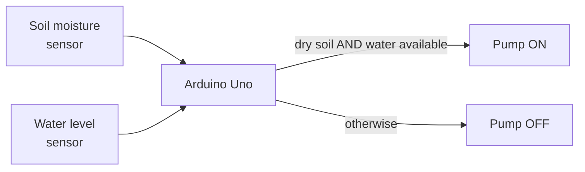

<h1 align="center">🌱 Smart Irrigation System · Arduino Uno</h1>

Waters plants only when the soil is dry — and only if there's water in the tank.

  
  
  

> **Status:** design write-up only. The sketch, diagrams and photos aren't in this repo yet
> ([details](#status--known-issues)).

## Overview

- **Reads** a soil-moisture sensor and switches a pump on below a threshold.
- **Protects** the pump: a water-level sensor stops it running dry.
- **Saves water** compared with timed watering.

## How it works

## Hardware

| Part | Role |
|---|---|
| Arduino Uno | Controller |
| Resistive soil-moisture sensor | Soil dryness |
| Conductive water-level sensor | Tank level |
| DC submersible pump (via relay / transistor) | Watering |
| Batteries, holders, breadboard | Power and wiring |

## Status & known issues

**What's missing from the repo:** the Arduino sketch, wiring diagram and photos (linked before but
never uploaded).

**Problems found while building**
- Resistive moisture probes corrode, so their readings drift over weeks.
- One moisture threshold doesn't suit every soil type.
- The pump's current draw drains small batteries quickly.
- Breadboard connections came loose.

## Roadmap

- [ ] Upload the sketch, wiring diagram and photos
- [ ] Capacitive moisture sensor (no corrosion)
- [ ] OLED readout; ESP32 for remote logging and alerts
- [ ] Solar power and weather-aware scheduling
